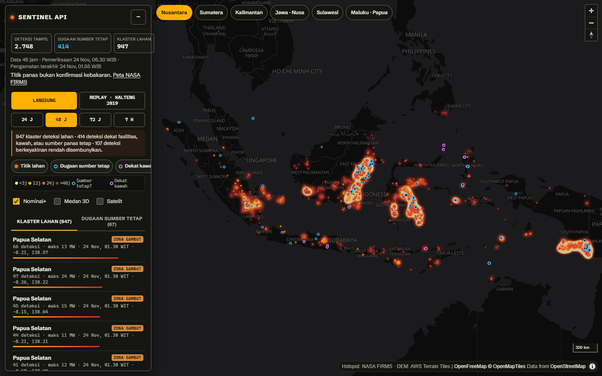
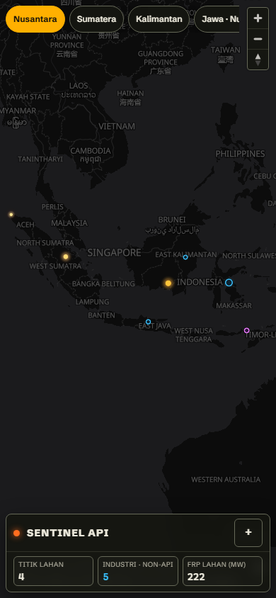
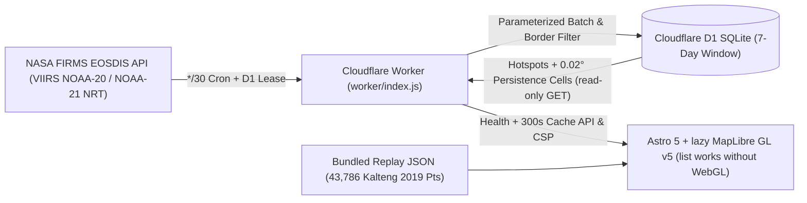

# Wildfire Watch · Sentinel Api

**Indonesia wildfire & peatland hotspot monitor powered by NASA FIRMS VIIRS 375 m — flagging likely stationary heat sources (coal power plants / PLTU, nickel smelters, oil & gas flares, kilns, active volcano craters) as suspected, separate from candidate vegetation and peatland fires (*karhutla*).**

[](https://fire.transbulent.id/)
[](https://firms.modaps.eosdis.nasa.gov/)
[](https://maplibre.org/)
[](https://workers.cloudflare.com/)
[](LICENSE)



---

## Why This Exists

Raw satellite thermal anomaly feeds over Indonesia routinely conflate **active vegetation and peatland fires (*kebakaran hutan dan lahan / karhutla*)** with **stationary industrial heat sources** (captive coal-fired power plants / PLTU, nickel & alumina smelters in Morowali, Weda Bay, Konawe, and Obi, upstream oil & gas flare stacks, cement kilns, pulp mills) as well as **active volcanic craters**.

On humid or non-peak fire days, stationary industrial infrastructure and degassing lava domes can dominate raw VIIRS hotspot counts—obscuring genuine early-stage peatland ignitions. **Wildfire Watch (`Sentinel Api`)** flags the likely stationary sources before rendering counts, clusters, or lists. A hotspot is a satellite thermal detection, not a confirmed fire, and one fire can be detected more than once. Fire Radiative Power (`FRP`, MW) is shown per detection, or as the maximum per detection in a cluster detail — it is never summed across passes into an MW total.

<details>
<summary>Mobile responsive preview (390×844 viewport with collapsible control sheet)</summary>

<p align="center">
  
</p>

</details>

---

## Key Capabilities

- **VIIRS 375 m NRT Ingestion (NOAA-20 + NOAA-21)**: A Cloudflare Worker cron (`*/30 * * * *`) pulls NRT thermal detections from the `VIIRS_NOAA20_NRT` and `VIIRS_NOAA21_NRT` FIRMS feeds over Indonesia (`94.0°E–141.02°E`, `11.5°S–6.5°N`) into Cloudflare D1 (7-day retention). Suomi NPP is not ingested or shown in live mode; it appears only in the offline Kalteng 2019 replay archive.
- **Data Health & Ingest**: Only the cron `scheduled` handler ingests, guarded by a D1 lease (`meta.scheduled_ingest_lease`, 20 min expiry, random owner token). `GET`/`HEAD` on `/api/hotspots` and `/api/status` never call FIRMS, never write to D1, and never claim the lease; the data endpoint is served from a 300 s Cloudflare Cache API entry or D1. Responses carry `health` (`state`, `checked_at`, `last_good_at`, `last_check_failed`, `sources`); a stale snapshot (last successful ingest ≥ 60 min old), a partial result, or an empty/unavailable database is shown as such, never as zero detections. A D1 with no ingest yet returns `200` with `health.state = "unavailable"` and `Cache-Control: no-store`.
- **Suspected Stationary Source Flagging**: Separates **Land / Peat Wildfire candidates** (`karhutla`, shown as "Klaster lahan") from **Suspected stationary sources** ("Dugaan sumber tetap": `#38bdf8` cyan rings for sites near a catalogued facility — PLTU, smelters, gas flares, cement/pulp kilns — or a repeating stationary thermal cell) and **Active Volcano craters** (`#e879f9` violet rings), with the stat cards "Deteksi tampil", "Dugaan sumber tetap", and "Klaster lahan", category toggles, and ranked lists. The categories are suspicions based on proximity and repetition, not proof of the source of any detection.
- **Cross-Border Territory Exclusion**: Edge- and client-side geometric border filtering (`isForeignTerritory`) excludes adjacent Malaysian, Singaporean, Bruneian, Timor-Leste, and Papua New Guinean detections inside the rectangular bounding box.
- **Hydrological Peatland Awareness (`GAMBUT`)**: Cross-references detections against approximate major Sumatran, Kalimantan, and South Papuan peatland corridors (`PEAT_CORRIDORS`) and exempts peatland zones from the repeating-cell (Tier 2) stationary flag so multi-day subterranean peat smoldering is never muted.
- **Archipelagic Framing & Time Zones**: Panel-aware initial framing across the full archipelago, 6 island camera presets (*Nusantara*, *Sumatera*, *Kalimantan*, *Jawa · Nusa*, *Sulawesi*, *Maluku · Papua*), fast 38-province spatial lookup, and automatic `WIB` / `WITA` / `WIT` local timestamp formatting. Place names and peat badges are approximate.
- **Historical Peat Megafire Replay (`Kalteng 2019`)**: Includes **`43,786`** archival VIIRS 375 m detections across Pulang Pisau – Palangka Raya (`1–20 September 2019`), interactive `O(log N)` 48-hour sliding window scrubber, and SVG FRP sparkline—running 100% locally with zero API keys needed.
- **Resilient Map Loading & 3D Terrain**: The page requests data first and imports MapLibre GL v5 lazily; the detection list and detail dialog keep working without WebGL or when the basemap fails. Optional 3D terrain relief (AWS Terrarium RGB DEM with procedural atmospheric sky fog) and an Esri World Imagery reference layer are toggleable.

---

## Scientific Methodology & Limitations

### 1. Two-Tier Thermal Source Classification (`src/scripts/thermal-sites.js`)

| Tier | Mechanism | Scope & Criteria | Output Category |
|---|---|---|---|
| **Tier 1** | Coordinate catalog (`THERMAL_SITES`) | **74** industrial/energy sites (metallurgical smelters, PLTU coal stations, oil & gas flares, coal mines, cement kilns, pulp mills) and **26** PVMBG active volcanoes with site-specific buffer radii (`2.5–7.5 km`). A detection inside a radius is flagged as near that facility/crater. | `industri` or `vulkanik` (shown as "Dekat fasilitas/kawah") |
| **Tier 2** | 7-day SQLite spatiotemporal persistence (`queryPersistentCells` + `classifyThermalPoint`) | Uncatalogued `0.02°` (~2.2 km) grid cells exhibiting **`≥ 2` distinct days**, **`≥ 4` distinct orbital passes**, **`≥ 60%` nighttime detections**, and compact spatial spread **`≤ 1.8 km`** (prefiltered at `≥ 55%` night / `≤ 2.0 km` in D1 SQL). **Explicitly disabled inside `PEAT_CORRIDORS`** so slow, stationary peat fires remain flagged as wildfire (`GAMBUT`). | `industri` (`Termal Tetap`, shown as "Dugaan sumber tetap") |
| **Default** | Remaining Indonesian detections | Vegetation, agricultural burning, forest/plantation fire, and peatland corridors. | `karhutla` (`Lahan / Hutan` or `Lahan Gambut`) |

Both tiers are heuristics: they mark a detection as a *suspected* stationary source, not a confirmed one, and an uncategorised detection is not necessarily a fire.

### 2. Known Scientific & Operational Limitations

1. **Pixel Footprint Mixing (375 m I-Band)**: Individual VIIRS I-band pixels cover ~375 m at nadir and expand toward swath edges; vegetation fires occurring within an industrial complex radius may be tagged as industrial context.
2. **Cloud & Dense Haze Attenuation**: Optical/infrared VIIRS retrievals cannot penetrate thick cumulonimbus clouds or optically opaque smoke plumes; low FRP counts during cloudy conditions do not imply fire extinguishment.
3. **Indicative Peatland Boundaries**: `PEAT_CORRIDORS` represents 7 macro hydrological basins (`Coastal Riau`, `Jambi`, `South Sumatra`, `West Kalimantan`, `Central Kalimantan`, `South Kalimantan`, `South Papua`) for rapid edge/client classification and does not replace official polygon delineations from KLHK / BRGM.
4. **Tier 2 Uncatalogued Biomass Kilns**: Stationary charcoal/agricultural dryers outside Tier 1 that operate continuously for multiple nights may be classified as `Termal Tetap` unless situated within a peatland corridor.
5. **Subterranean Smoldering Underestimation**: Low-temperature deep peat smoldering beneath intact canopy can fall below satellite NRT detection thresholds (`nominal` confidence or omitted entirely).
6. **Duplicate Detections & FRP**: A single fire can be detected on several passes and by both satellites, so detection counts are not fire counts and clusters are groups of nearby points, not confirmed fires. FRP is per detection, not burned area or an accumulation over time, and is deliberately not summed into an MW total.
7. **Ingest Latency & Health**: Data lags by FIRMS NRT latency, the 30-minute cron, and the 300 s cache. If ingest stops, the UI marks the data stale instead of showing zero detections; if the Worker has no cron trigger, no data is ever ingested.

---

## Edge & Frontend Architecture



**Security Highlights** (see [SECURITY.md](SECURITY.md)):
- `FIRMS_MAP_KEY` lives exclusively as a Cloudflare Worker Secret (`env.FIRMS_MAP_KEY`), never in browser bundles or public configs. Only the scheduled ingest uses it; `GET`/`HEAD` requests never reach FIRMS.
- `X-Robots-Tag: noindex` prevents raw `/api/*` JSON responses from entering search indexes while allowing Googlebot Web Rendering Service to render live map summaries.
- `Permissions-Policy` disables `geolocation`, `camera`, and `microphone`; the app never requests the user's location.
- All D1 queries use strict parameterized `.bind(...)` statements; static assets enforce strict CSP, HSTS, and `frame-ancestors 'none'`.

---

## Ringkasan Bahasa Indonesia

**Wildfire Watch (`Sentinel Api`)** adalah aplikasi pemantau titik panas (*hotspot*) kebakaran hutan dan lahan (*karhutla*) Indonesia berbasis satelit **NASA FIRMS VIIRS 375 m** secara *real-time* yang dapat diakses langsung di **[fire.transbulent.id](https://fire.transbulent.id/)**.

Fitur utama untuk analis, peneliti gambut, jurnalis data, dan pemantau kebencanaan:
- **Penandaan Dugaan Sumber Tetap**: Menandai deteksi yang berada dekat **74 kawasan industri** (PLTU batubara, smelter nikel/bauksit/tembaga, suar migas, pabrik semen/pulp) dan **26 gunung api aktif PVMBG**, serta sel stasioner multi-hari di Cloudflare D1, sebagai *dugaan* sumber tetap, bukan bukti sumber. Kartu utama menghitung deteksi tampil, dugaan sumber tetap, dan klaster lahan; FRP hanya ditampilkan per deteksi atau maksimum per deteksi dalam detail klaster, tidak dijumlahkan menjadi total MW.
- **Lencana Hidrologis `GAMBUT`**: Menandai klaster kebakaran pada 7 koridor gambut utama Sumatera, Kalimantan, dan Papua Selatan serta memastikan sel berulang di lahan gambut tidak dianggap sumber industri.
- **Status Data yang Jujur**: Data live berasal dari VIIRS NOAA-20 dan NOAA-21 dan diperbarui oleh cron setiap 30 menit; Suomi NPP hanya ada pada arsip replay. Permintaan GET tidak memicu pengambilan data. Antarmuka membedakan memuat, terkini, parsial, tertinggal, kosong, dan tidak tersedia, sehingga gangguan tidak terbaca sebagai nol deteksi. Daftar dan detail tetap bisa dipakai bila WebGL atau peta dasar gagal.
- **Fokus Kepulauan & Zona Waktu Lokal**: Navigasi cepat 6 koridor wilayah, identifikasi 38 provinsi, konversi waktu otomatis (`WIB`/`WITA`/`WIT`), serta mode **Replay Karhutla Kalteng 2019** (43.786 deteksi di Pulang Pisau – Palangka Raya) yang berjalan lokal tanpa memerlukan kunci API.

---

## Quickstart

### 1. Local Frontend + Offline Replay (Zero API Keys Required)

```bash
git clone https://github.com/gisrad/wildfire-watch.git
cd wildfire-watch
npm install
npm run dev
```

Open `http://127.0.0.1:4324/` and switch to **Replay · Kalteng 2019** to explore the full `43,786`-point Central Kalimantan dataset locally. (In plain `astro dev` without Wrangler, `/api/hotspots` is served by the Worker when deployed or via `wrangler dev`.)

### 2. Production Deployment on Cloudflare Workers + D1

1. Copy the sanitized Wrangler template:
   ```bash
   cp wrangler.toml.example wrangler.toml
   ```
   *(Notice `wrangler.toml` is gitignored so your personal `account_id` and `database_id` stay local.)*
2. Provision D1 and apply the SQL schema (`worker/schema.sql`) — no other migration is needed:
   ```bash
   npx wrangler d1 create wildfire-watch
   # Paste the returned database_id into wrangler.toml
   npx wrangler d1 execute wildfire-watch --remote --file=worker/schema.sql
   ```
3. Configure your free NASA FIRMS MAP Key ([request a FIRMS key](https://firms.modaps.eosdis.nasa.gov/api/map_key/)):
   ```bash
   npx wrangler secret put FIRMS_MAP_KEY
   ```
   *(The key stays a server-side Worker secret; it is never placed in `wrangler.toml` or shipped to the browser.)*
4. Keep the cron trigger from the template (`[triggers] crons = ["*/30 * * * *"]`) in your `wrangler.toml`. **It is required:** only the scheduled handler ingests FIRMS data (guarded by a D1 lease), and API `GET`/`HEAD` requests never fetch upstream or write D1. Without the cron trigger the API stays empty (`200`, `health.state = "unavailable"`, `Cache-Control: no-store`) and the UI shows data as unavailable. After the first cron run, check `/api/status`: `last_attempt.ok` should be `true` and every active source `ok` or `empty`.
5. Verify security hygiene, build static Astro assets, and deploy:
   ```bash
   npm run check:security
   npm run build
   npx wrangler deploy
   ```

### 3. Rebuilding Historical Replay Data (Optional)

```bash
FIRMS_MAP_KEY=your_key_here npm run bake:replay
```

---

## Repository Structure

```text
wildfire-watch/
├── astro.config.mjs            # Astro 5 static build config
├── wrangler.toml.example       # Sanitized Cloudflare Worker + D1 template
├── worker/
│   ├── index.js                # Edge router, read-only GET API, scheduled FIRMS ingest, D1 queries & cache
│   ├── sentinel-ingest.js      # D1 ingest lease, ingest health & public run summaries
│   └── schema.sql              # D1 detections + meta schema
├── src/
│   ├── lib/
│   │   ├── sentinel-live.js    # Data-first live feed, health states & detail dialog
│   │   ├── sentinel-map.js     # Lazy MapLibre loader with no-WebGL fallback
│   │   └── sentinel-status.css # Status & fallback panel styles
│   ├── pages/
│   │   ├── index.astro         # UI shell, JSON-LD SEO, & responsive layout
│   │   └── 404.astro           # Minimal dark-theme 404 page
│   └── scripts/
│       ├── fire.js             # MapLibre GL v5 controller, layers & replay engine
│       ├── indonesia.js        # Archipelago camera presets, 38 provinces, TZ & peat corridors
│       └── thermal-sites.js    # Border filter & 2-tier industrial/volcano classifier
├── scripts/
│   ├── bake-replay.mjs         # Archival FIRMS SP dataset builder
│   └── security-check.mjs      # Automated pre-push secret/ID/email scanner
├── public/
│   ├── data/replay-kalteng-2019.json
│   ├── fonts/                  # Self-hosted Schibsted Grotesk WOFF2 + OFL-1.1 license
│   ├── og-fire.png             # OpenGraph / Twitter social card (1200×630)
│   ├── robots.txt & sitemap.xml
├── CITATION.cff                # Machine-readable software citation metadata
├── SECURITY.md                 # Threat boundaries & vulnerability disclosure
└── LICENSE                     # MIT License + third-party data notices
```

---

## Citation & Data Attribution

If you reference this tool or its two-tier stationary industrial filter in academic work, please use GitHub's **"Cite this repository"** sidebar widget ([CITATION.cff](CITATION.cff)):

- **Satellite Active Fire Data**: NASA FIRMS EOSDIS — VIIRS 375 m Active Fire Product ([Schroeder et al., 2014, *Remote Sensing of Environment* 143:85–96](https://doi.org/10.1016/j.rse.2013.12.008)). *Disclaimer: NASA promotes the full and open sharing of all data with research and applications communities; VIIRS 375 m NRT detections carry ±375 m spatial resolution and are subject to cloud cover and thermal saturation limits.*
- **Basemaps, DEM & Fonts**: Vector tiles by [OpenFreeMap](https://openfreemap.org/) / © OpenStreetMap contributors · Elevation RGB terrain by AWS Terrain Tiles (Mapzen/Tilezen) · Reference satellite imagery by Esri World Imagery · Typography using [Schibsted Grotesk](public/fonts/OFL.txt) (SIL OFL 1.1).

## License

Code in this repository is released under the [MIT License](LICENSE). See [THIRD_PARTY_NOTICES.md](THIRD_PARTY_NOTICES.md) for font and dataset attributions.
